# Taproot Studio — Project Handbook

> The single reference for everything decided, explored, and still open on Taproot Studio.
> Consolidates the scoping interviews, the vision/Phase 1 docs, the belief-graph tool, and the
> interface concept designs.
>
> **Last updated:** 2026-09-29

## How to read this document

Every item carries one of these labels so it is clear how settled it is:

| Label | Meaning |
|-------|---------|
| **Locked** | Explicitly decided by the project owner. Binding until changed. |
| **Provisional** | Stated direction, but expected to be refined. |
| **Interpretation** | Reading of a concept image or discussion that has **not** been confirmed yet. |
| **Open** | Undecided; needs a decision. |

Related documents:
- `PROJECT_VISION.md` and `PHASE_1_PLAN.md` — the formal vision and Phase 1 plan (PR #1).
- `tools/belief-graph/README.md` — the belief-graph MCP tool (PR #2).
- `docs/design/concepts/` — the original concept images referenced in §11.

---

## Contents

1. [What Taproot Studio is](#1-what-taproot-studio-is)
2. [Guiding principles](#2-guiding-principles)
3. [Origin: the two source projects](#3-origin-the-two-source-projects)
4. [Locked architectural decisions](#4-locked-architectural-decisions)
5. [Signature concepts](#5-signature-concepts)
6. [Workspace & interaction model](#6-workspace--interaction-model)
7. [Project Board](#7-project-board)
8. [Execution engine: current reality vs. target](#8-execution-engine-current-reality-vs-target)
9. [System architecture & data model](#9-system-architecture--data-model)
10. [Belief graph (scoping tool)](#10-belief-graph-scoping-tool)
11. [Design language & concept designs](#11-design-language--concept-designs)
12. [Roadmap](#12-roadmap)
13. [Risks](#13-risks)
14. [Open questions](#14-open-questions)
15. [Glossary](#15-glossary)
16. [Artifacts & links](#16-artifacts--links)
17. [Appendix: concept image index](#appendix-concept-image-index)

---

## 1. What Taproot Studio is

**Locked.** Taproot Studio is an **agent-native, re-imagined IDE**. It is a pivot of Geminode Studio
(a node-based agent workflow designer) into a general-purpose IDE, fused with Reaction Studio's
Electron IDE shell and neumorphic design language.

Where mainstream "AI IDEs" hide the agent behind a chat sidebar with a fixed prompt and toolset,
Taproot **exposes the agent layer as something the user designs**:

- how sub-agent flows are structured and orchestrated,
- how agents communicate (with each other and with the user),
- which tools each agent can reach,
- how agent behavior changes at runtime (Agent States),
- how much autonomy vs. human review exists (designed into the flow, not a global switch).

All of this is authored through a **node-based flow editor embedded in the main UI** — a surface of
the workspace can be flipped over to create or manage flows.

> "We shouldn't think of this app in the standard IDE context. It's an IDE, but a fundamentally
> re-thought and re-imagined IDE." — project owner

**Scope — Locked.** General-purpose IDE for **any language**, with emergent functionality tailored
to specific languages where useful.

---

## 2. Guiding principles

1. **Re-thought, not re-skinned.** Do not reason about Taproot in the standard IDE frame. The mental
   model is "a malleable agent runtime that is also a great editor."
2. **Emergent UI/UX (Locked, core belief).** Comprehensive functionality, but intuitive and clean
   because **UI only appears when it is actually needed**. Default state is calm; complexity is
   on demand (edge drawers, hover-to-expand panels, radial menus, flip-to-edit).
3. **Agents are designable, not hidden.** Flows, tools, context strategy, and runtime behavior are all
   first-class authoring surfaces.
4. **No file-shuffling.** Flows and tools live in a local service and are *referenced* into projects;
   they are never copied between directories by hand.
5. **Composable trust.** Human-in-the-loop is a pattern the user wires into a flow, not a fixed mode.

---

## 3. Origin: the two source projects

Both live in this repo as git submodules under `packages/`.

| Project | Stack | What Taproot takes from it |
|---------|-------|----------------------------|
| **Geminode Studio** (`packages/geminode-studio`) | React 19 frontend + **Python FastAPI backend** | The flow editor, the agent node model, and the **execution engine** (`backend/flowcore/`). |
| **Reaction Studio** (`packages/reaction-studio`) | Electron, React 18, Monaco, Babel/ts-morph, zustand | The Electron shell, `electron/project-manager.ts` (filesystem), live preview (`vite-plugins/component-server.ts`), AST tooling, the minimal code editor, and the **neumorphic design system** (`src/styles.ts`). |

Repo notes:
- The repo root is currently a monorepo shell (`.gitmodules` + two submodules); there is no root
  workspace tooling yet.
- Initialise with `git submodule update --init --recursive`. Reaction Studio's submodule URL is SSH
  (`git@github.com:bloomresearch/ReactionStudio.git`); rewrite to HTTPS if SSH is unavailable.
- The Geminode submodule pointer may lag its `main` branch; check out `main` and pull to get `backend/`.
- Geminode's old TypeScript executor (`services/workflowExecutor.ts`, `geminiService.ts`) has been
  **removed**. Execution lives in the Python backend; the frontend calls it via
  `services/backendService.ts`.

---

## 4. Locked architectural decisions

| # | Area | Decision |
|---|------|----------|
| 1 | Distribution | A **single Electron desktop app**. Reaction Studio's Electron shell + project manager is the backbone; Geminode's flow editor is ported in as an in-app, flippable surface. |
| 2 | LLM providers | A **multi-provider abstraction** behind one interface — Gemini, OpenAI, Anthropic, local/Ollama — **Gemini first**. |
| 3 | The "brain" | A **single local Python daemon** (FastAPI + WebSocket), bundled and **auto-spawned by Electron**. Owns flow storage, execution, the LLM layer, tool execution, and the vector store. Electron is a thin client over HTTP/WS. The existing Geminode `backend/` is its basis. |
| 4 | Flow storage | **Global, daemon-owned.** Flows are imported/enabled into a project **by reference**, never copied as files. |
| 5 | Data layer | **SQLAlchemy.** SQLite by default; pluggable to Postgres/MySQL. Chosen because users will register **their own databases** in the node editor for LLMs to query — one abstraction for internal and user data. |
| 6 | Vectors (RAG + ECP) | **sqlite-vec** by default; **pgvector** when backed by Postgres. |
| 7 | Custom tools | User-authored **Python** tools run in an **isolated subprocess / managed venv** with declared inputs, outputs, and timeouts. |
| 8 | Default toolset | Built-in tools including AST-skeleton retrieval, file read/write, search, copy, move — extensible by users. |

---

## 5. Signature concepts

### 5.1 Flippable Agent surface — Locked
The Agent surface flips over to reveal the node-based flow editor in place. The flow designer is a
*face* of the workspace, not a separate app or mode.

### 5.2 Agent Node States — Locked
Each agent node can declare **multiple named states**. A state is a configuration bundle: model,
system prompt, enabled tools, ECP toggle, structured-output / function-calling setup, etc. Flow
handles can **set or trigger state transitions at runtime**, making each agent node a small,
author-controlled state machine inside the larger graph.

### 5.3 Emergent Context Protocol (ECP) — Locked
A **meta-RAG over the tool registry** that solves tool overload (models given too many tools tend to
use none of them well).
- Each tool registers **multiple scenario descriptions** — focused statements of *when* it is useful.
- ECP embeds the agent's **running thoughts/output** and surfaces the **top-K relevant tools** each
  turn, dynamically shaping the tool list the model sees.
- **Optional per agent** (and per state).

### 5.4 RAG nodes & user data sources — Locked
A first-class RAG node for retrieval in any flow. Users register **their own databases** (via
SQLAlchemy) as agent-accessible context directly in the node editor.

### 5.5 Tool Builder — Locked
A dedicated panel: UI controls for the declarative part (name, description, ECP scenarios, typed
parameters, timeout) plus a **small embedded Python editor** for the tool body. Tools become
first-class, ECP-registered citizens of the runtime.

### 5.6 The Orchestrator — Locked
- Every **new chat starts with the primary Orchestrator agent** loaded.
- The Orchestrator is **not special-cased machinery**: it is a **default-but-fully-editable flow**
  that can be opened and reshaped in the node editor. Project/codebase-aware and ECP-enabled.
- Its per-surface behavior is expressed with **Agent States** (e.g. a "Code Orchestrator" state on the
  IDE, a "Node-Graph Designer" state on the Agent surface) — the product dogfoods its own States
  feature.
- Users can **attach a different flow** to a chat to talk to that flow directly.

**Ways to invoke a flow (Locked):**
1. Through the Orchestrator in the slide-out chat (the Orchestrator can call flows).
2. By loading a flow directly into a chat to communicate with it manually.
3. Through **automatic triggers or schedules**.

### 5.7 Contextual edge drawer — Locked
The main chat affordance is an **emergent edge drawer**: move toward a screen edge and a chat panel
slides out (reference: Reaction Studio's asset-library drawer). It is **contextual to the surface**
(carries the Orchestrator state for where the user is) and **absent where redundant** — e.g. the Agent
surface is already a chat.

### 5.8 Composable trust & the Diff node — Locked direction
- There is **no global autonomy setting**. How agents find, read, and edit code — and where humans
  review — is designed into the flow.
- Any node's output can be **routed to the Chat UI Output** (text now; buttons, inputs, and forms later
  via the existing `ui_interactive` node and engine pause/resume).
- A built-in **Diff node** (planned) shows the difference between two code versions. Paired with a UI
  pause, it forms a composable approve/reject step (`diff → approve`).

### 5.9 Loops and async execution — Locked requirements
- Nodes can **loop back** to a previous node. (The engine already supports this; see §8.)
- **Optionally asynchronous** execution: nodes, or individual node inputs/outputs, can be set to async.
  (Not built yet; see §8.)

---

## 6. Workspace & interaction model

### 6.1 Five persistent surfaces — Locked
Arranged as a cross, with the **IDE at the canonical center**:

```
                 [ Concept Designer ]
                          |
       [ Agent ] —— [   IDE   ] —— [ Project Board ]
                          |
                 [ Knowledge Base ]
```

| Surface | Purpose |
|---------|---------|
| **IDE** (center) | Code view & editor. The default surface. |
| **Agent** | Chat, plus the flip to the node/flow editor. |
| **Project Board** | Project management, agent management, progress tracking (§7). |
| **Concept Designer** | Multimodal blackboard/whiteboard for illustrating concepts *for* an agent; drawings become agent input. |
| **Knowledge Base** | User-added knowledge and agent databases. |

### 6.2 Swap-rotation navigation — Locked
The user drags the workspace up/down/left/right to move between surfaces, rendered as a fluid
full-screen rotation. One rule governs everything:

> Rotating in a direction brings that surface to center, and **the IDE drops into the slot you rotated
> from**. Repeating the same gesture returns to the IDE. The opposite gesture reaches the opposite outer
> surface. Switching axis re-centers that axis on the IDE.

Canonical gestures from the IDE: **up → Concept Designer**, **down → Knowledge Base**,
**left → Agent**, **right → Project Board**.

Worked traces:
- `up, up` → Concept Designer → **IDE** (repeat = home)
- `up, down` → Concept Designer → **Knowledge Base** (opposite outer)
- `up, down, down` → CD → KB → **IDE**
- `up, down, up` → CD → KB → **Concept Designer**

Only the IDE "floats"; outer surfaces keep fixed relationships. Mnemonic: *repeat to go home*.

### 6.3 Mini-compass — Locked
A live miniature of the surface arrangement: small rectangles swap in **simulated depth**, the
centered surface is drawn largest, and the IDE's current slot is shown in its **highlight colour**.
Optional accelerators (click a tile, number keys 1–5) — orientation aids, not replacements for spatial
navigation. Colour is always paired with icon + label for accessibility.

### 6.4 Emergent UI patterns — Locked
- **Edge drawer** — pointer-to-edge reveals contextual chat (§5.7).
- **Hover/intent-to-expand** — collapsed panels expand on intent; e.g. the code editor slides out and
  expands on hover to conserve space.
- **Flip-to-edit** — a surface flips to reveal its authoring view (Agent → flow editor).
- **Radial/spiral menus** — context actions appear around the pointer only when invoked (§11.6).

---

## 7. Project Board

**Provisional — to be refined in a later round.**

- Hierarchy: **projects ▸ milestones ▸ sprints ▸ issues ▸ blocking** relationships.
- **Both agents and users** create and update the board. An agent working a task can **automatically
  create issues, assign itself, and update them as it goes**. In-progress issues show the agent's
  current step live; done issues show a short summary.
- A per-node **"track via kanban"** toggle controls whether an agent boards its work.
- Users can create an issue and **assign a flow** to it.
- Layouts: **kanban**, plus an optional **flow-graph layout** (issues as nodes with connecting lines).
- Emergent interactions: hover an issue → it expands (neighbours shrink); click → issue on one side,
  chat on the other; roadmap: click an aspect of an issue to jump to the exact point in the agent chat
  where it was worked on.

---

## 8. Execution engine: current reality vs. target

Verified in code: `packages/geminode-studio/backend/flowcore/engine.py` (`WorkflowEngine`).

**Already works**
- **Async + streaming** (`asyncio`, `execute_stream`) with work-queue traversal.
- **Multi-input joins** — `_is_ready` holds a node until all forward-incoming handles have values.
- **Loop-back** — `_find_back_edges` (DFS) classifies cycle edges; back-edges re-queue their target,
  capped by `MAX_NODE_EXECUTIONS = 25` per node.
- **Conditional routing** via function-call and structured-output handles.
- **UI pause/resume** — `PauseManager` + `asyncio.Event`; the `ui_interactive` node emits `ui_pause`
  with a `resumeToken`. This is the substrate for Chat UI Output and human-in-the-loop gates.
- FastAPI endpoints: `/workflow/execute`, `/workflow/resume`, `/workflow/models`, `/files/upload`,
  system-prompt/UI generation. A `pytest` suite exists (`backend/tests`).

**Not yet built**
- **True parallelism** — the queue drains one node at a time, so independent branches interleave.
  Target: run all ready nodes concurrently plus per-node / per-port async opt-in.
- **Provider abstraction** — the backend is Gemini-only today.
- **Persistence** — the backend is stateless (flows are `flows/*.json` + frontend `localStorage`).
  SQLAlchemy store and vectors are greenfield.
- Node types beyond `start`, `end`, `gemini_text`, `ui_interactive`: tool nodes, RAG, ECP, Agent States,
  Loop node, Diff node.

**Rule:** extend `flowcore`, do not re-port it. Preserve its async/join/loop semantics and test suite.

---

## 9. System architecture & data model

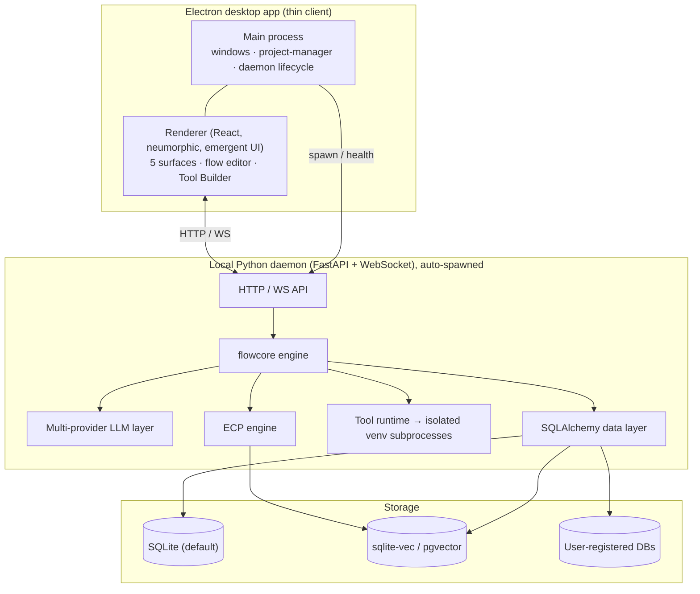

**Core entities (initial sketch, Provisional):** `FLOW`, `FLOW_NODE`, `FLOW_EDGE`, `PROJECT`,
`PROJECT_FLOW_LINK` (enable-by-reference), `AGENT_STATE`, `TOOL`, `TOOL_SCENARIO` (ECP embeddings),
`TOOL_VERSION`, `STATE_TOOL_LINK`, `DATA_SOURCE` (user DBs), and the board entities `MILESTONE`,
`SPRINT`, `ISSUE`, `ISSUE_BLOCK`, `ISSUE_EVENT`. The full ER diagram is in `PROJECT_VISION.md` §6.

---

## 10. Belief graph (scoping tool)

A standalone Python MCP service at `tools/belief-graph/` (PR #2). Purpose: let an agent maintain a
model of the project's decisions and **find knowledge gaps**, so it can ask informed questions while
scoping.

- **Epistemic, not plain GraphRAG.** Nodes are *beliefs* with `type`, `status`, `confidence`, and
  provenance.
  - Types: decision, assumption, requirement, constraint, preference, risk, open_question, fact.
  - Statuses: proposed, assumed, confirmed, locked, rejected, contradicted, stale.
  - Edges: supports, contradicts, depends_on, refines, answers, derived_from, scopes.
- **Append-only SQLite event log is the source of truth**; the graph is a derived, rebuildable
  projection.
- **Swappable graph backend** behind `IGraphStore`: local NetworkX backend (default, tested) and an
  experimental Graphiti/Kùzu backend.
- **Gap ranking** (impact × uncertainty): coverage, confidence, missing rationale, unanswered
  questions, unaddressed requirements, contradictions.
- **MCP tools:** `ingest`, `get_gaps`, `suggest_questions`, `query`, `add_belief`, `add_edge`,
  `set_status`, `get_contradictions`, `get_belief`, `stats`.
- **Status:** 11 tests passing on the local backend. The Gemini extractor has **not yet been verified
  against a real key**, and the Graphiti backend is untested.

---

## 11. Design language & concept designs

The concept images are early explorations generated/edited with AI assistance. Occasional label typos
(e.g. "Acerts", "Piles", "Modcl", "Roady") are artifacts; read labels by intent.

### 11.1 Colour palette — Provisional

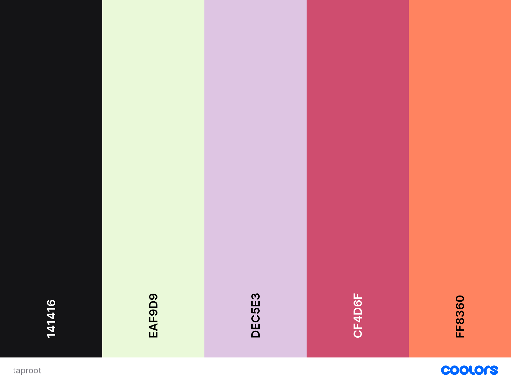

| Hex | Name (working) | Role (Interpretation, from how the concepts use it) |
|-----|----------------|------------------------------------------------------|
| `#141416` | Charcoal | Base surface for everything. |
| `#EAF9D9` | Mint | "On / live / healthy" signals: LED dots, active icon glows, the Ready indicator. |
| `#DEC5E3` | Lilac | Secondary accent (e.g. input handles, edge types). |
| `#CF4D6F` | Rose | End of the primary accent gradient. |
| `#FF8360` | Coral | Start of the primary accent gradient. |

The primary accent is the **coral → rose gradient** (`#FF8360` → `#CF4D6F`, orange on the left to
pink on the right). This replaces the earlier "amber/copper accent (TBD)" in `PROJECT_VISION.md` §4.5.

### 11.2 Surface & lighting rules

- **Dark, professional neumorphism** (not decorative): soft extruded and inset forms on charcoal,
  dual shadows, generous radii. Based on Reaction Studio's `src/styles.ts`.
- **One consistent light source from the top-left — Locked (owner correction).** Raised surfaces
  (knob faces, toggle thumbs, raised panels) have a subtle gradient — lighter top-left, darker
  bottom-right — so they read as gently rounded. Surfaces keep the charcoal hue; the light and shadow
  give them shape.
- **Glow layers on top to show state.** "Active" is shown by light: a gradient rim, arc, LED dot, or
  glowing icon. Inactive controls are flat grey with no glow.
- **Two accent meanings (Interpretation):** the coral → rose gradient means *active value / selection /
  intensity* (selected node rim, slider fill, knob arc, primary buttons, hovered menu sector); mint means
  *on / live / healthy* (LED dots, status, active icon).
- **Typography (Interpretation):** small, wide-tracked uppercase labels in muted grey; values brighten
  when their control is active.
- **Accessibility:** never rely on colour alone — pair with icon, label, or shape.

### 11.3 Shell layout (node editor view)

| Interface reconceptualization | Abstract base (no components) |
|---|---|
| 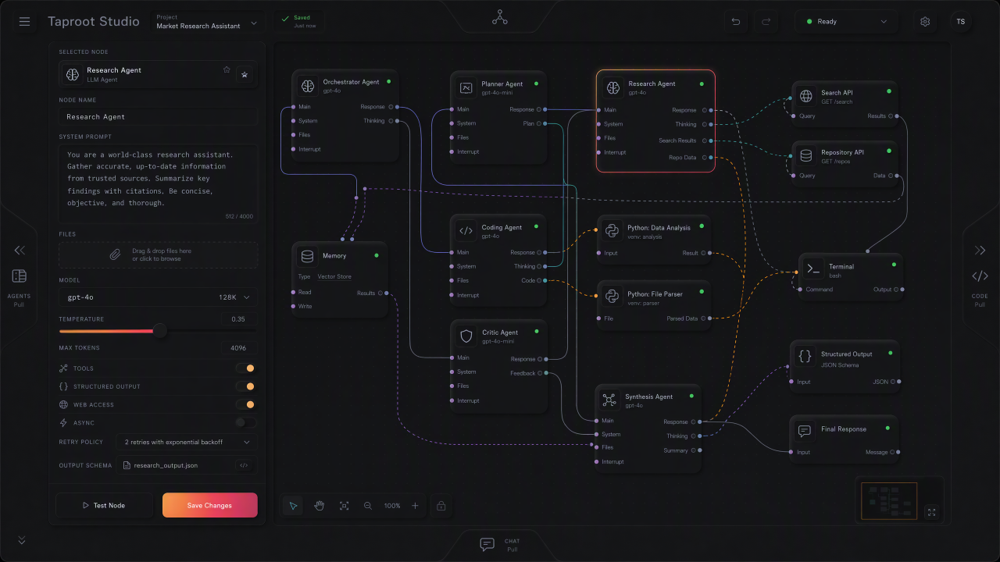 | 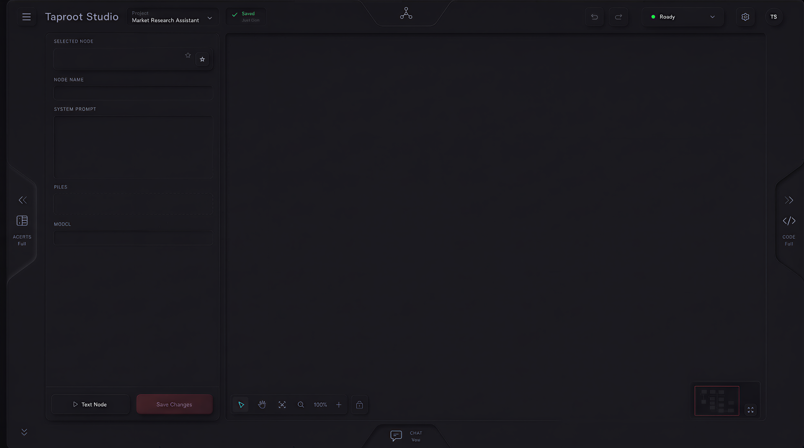 |

- **Top bar (inset):** menu, "Taproot Studio" wordmark, project selector, save state ("Saved · just
  now"), a centered notched tab with the graph icon, undo/redo, run status ("Ready" + mint dot),
  settings, avatar.
- **Edge tabs (notched into the frame):** left = **Agents** (pull), right = **Code** (pull), bottom =
  **Chat** (pull). These are the emergent edge drawers from §5.7 and §6.4.
- **Left inspector (selected node):** node name (favourite/star), system prompt (with a character
  counter), files, model, temperature slider (gradient fill), max tokens, toggles for Tools, Structured
  Output, Web Access, Async; retry policy; output schema. Footer: Test Node + Save Changes (gradient).
- **Canvas:** graph with typed, colour-coded edges (solid and dashed); bottom-left toolbar (select,
  pan, fit, zoom level, zoom in, lock); bottom-right minimap with expand.
- **Example flow ("Market Research Assistant"):** Orchestrator, Planner, Research, Coding, Critic, and
  Synthesis agents; Memory (vector store); Python tool nodes each with their own venv (data analysis,
  file parser); Search API; Repository API; Terminal; Structured Output; Final Response.
- **Interpretation:** the top-center notch with the graph icon is a current-surface indicator (and a
  candidate home for the mini-compass). **Open** — see §14.

### 11.4 Controls: toggles and knobs

| Toggle v2 — gradient rim | Toggle v3 — labeled + LED | Toggle v1.1 — icon thumb |
|---|---|---|
| 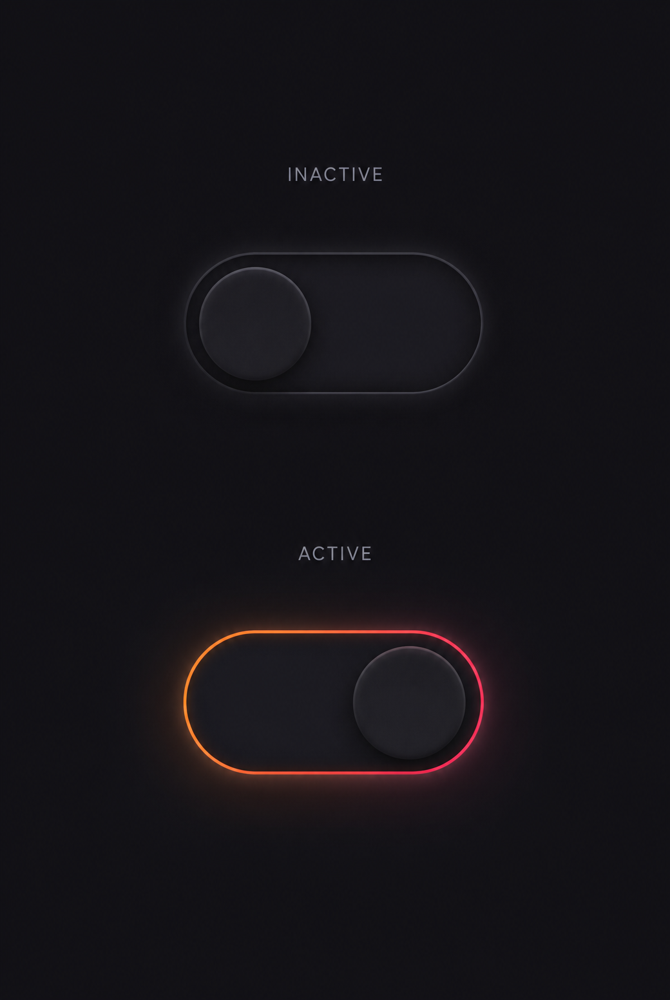 | 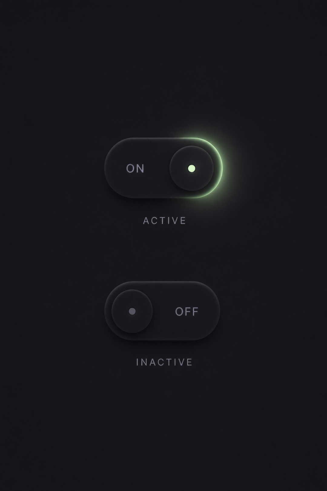 | 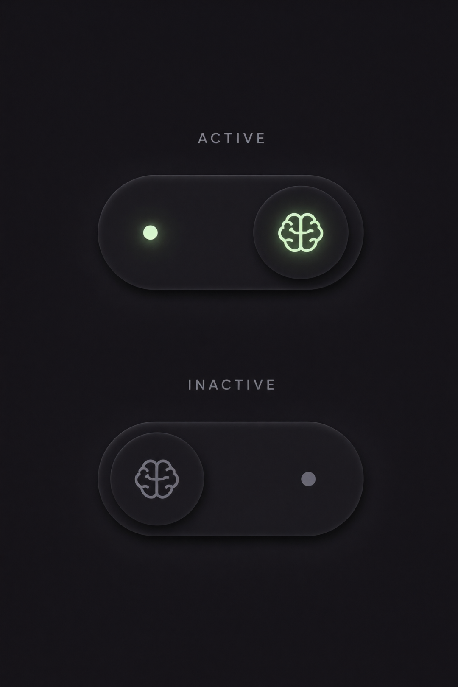 |

- **v2:** inset track, raised thumb; active = glowing coral → rose outline around the track.
- **v3:** extruded pill with ON/OFF text; active = mint glow along the thumb edge + mint LED dot in
  the thumb.
- **v1.1:** the thumb holds an icon (brain) that glows mint when active; an LED dot sits in the track.
  Lets a toggle carry its own meaning (e.g. Thinking, ECP) without an extra label.

| Knob v1 — arc gauge | Knob v2 — lit ring |
|---|---|
| 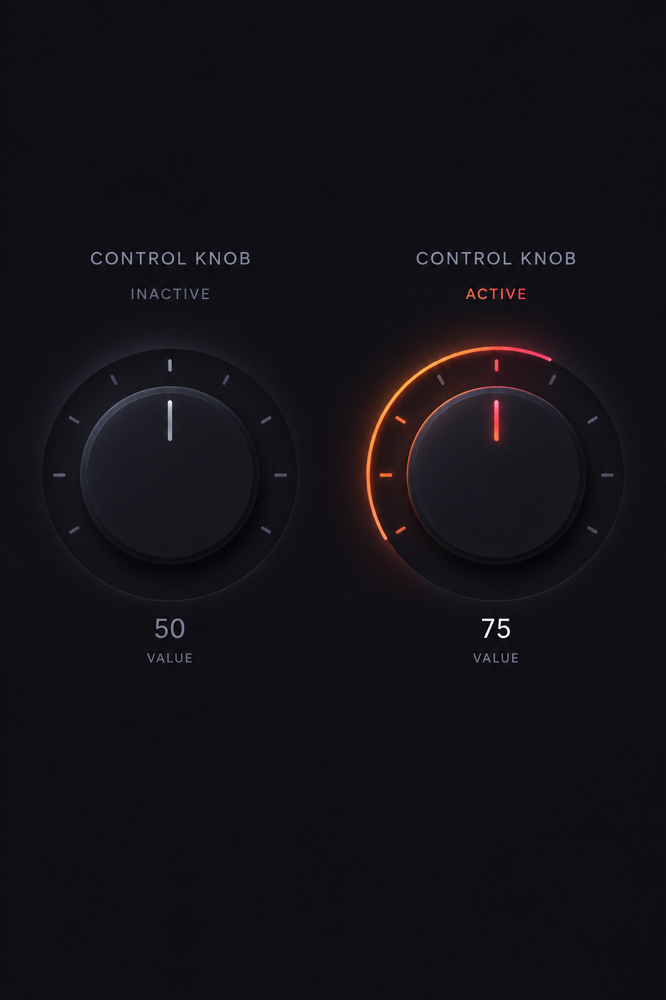 | 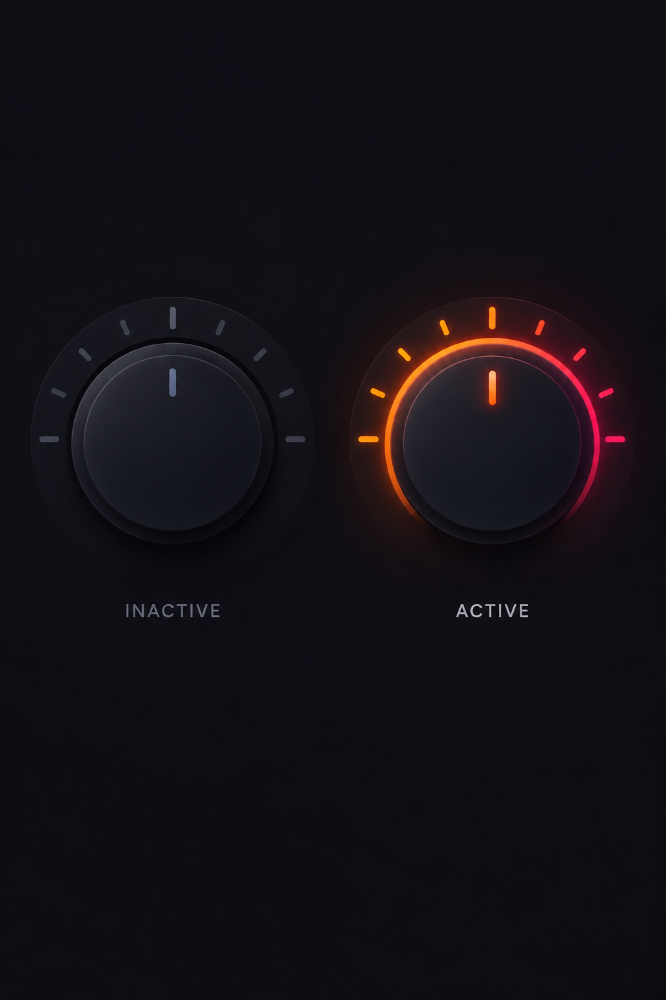 |

- Domed face lit from the top-left; tick ring; active = coral → rose arc (v1) or lit ring + lit ticks
  (v2); value readout turns from grey to white when active.
- **Owner note:** a knob may never be needed — **the visual style is what matters**. The same
  arc/tick/glow language applies to sliders and progress rings. (Possible use: bounded numeric
  settings like temperature in a compact node view.)

### 11.5 Node component

| Node v1 | Node v2 | Node v3 |
|---|---|---|
| 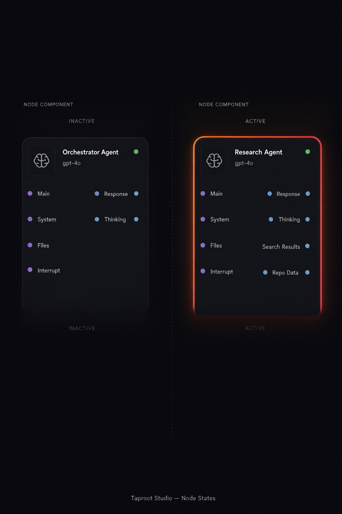 | 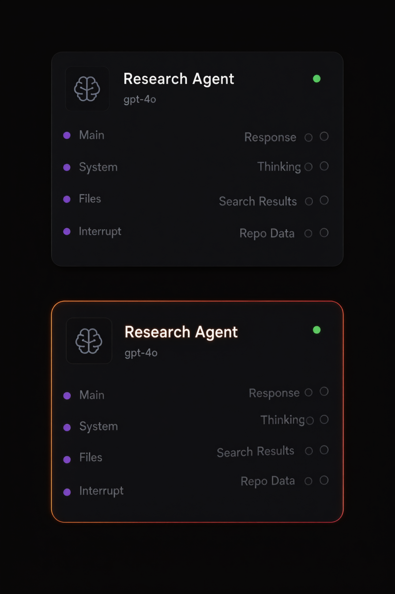 | 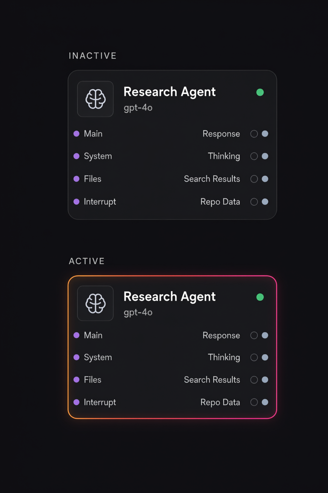 |

Shared anatomy:
- **Header:** inset icon tile (brain for agents), node name, model subtitle (e.g. `gpt-4o`), status dot
  (green/mint) at top-right.
- **Inputs (left, purple dots):** Main, System, Files, Interrupt.
- **Outputs (right):** Response, Thinking, plus **tool-specific outputs** that appear per node (the
  Research Agent adds Search Results and Repo Data). This fits tool nodes and Agent States.
- **Active/selected state:** coral → rose gradient rim with soft outer glow. Inactive: thin neutral
  border.
- Variant differences: v1 has the strongest glow; v2 the most restrained rim; v3 is the cleanest and
  most legible.
- **Open:** v2 and v3 show **two circles per output** (hollow + filled). Unknown whether this is a
  data handle + a separate state-transition/trigger handle, or an image-generation artifact.
- **Open:** handle colours (purple/blue) are outside the palette; decide whether to map them to
  palette colours or keep a separate data-type colour set.

### 11.6 Radial / spiral menus — Open (undecided)

Owner: *"Haven't decided which of the spiral designs I like … it may end up depending on what I feel
works visually best with the editor once I see it."*

| v1 — wedge ring | v2 — true spiral |
|---|---|
| 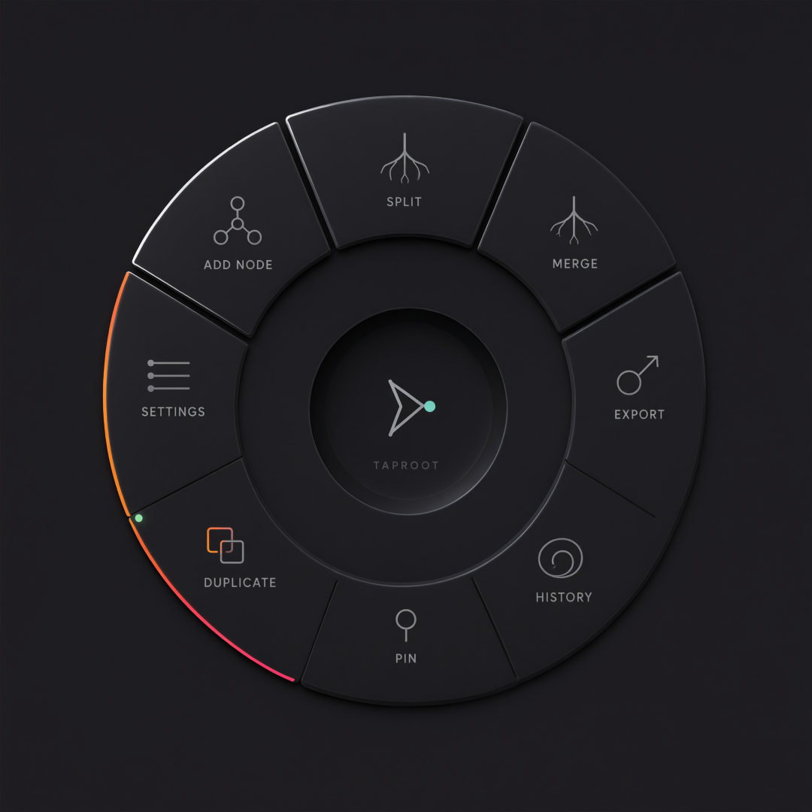 | 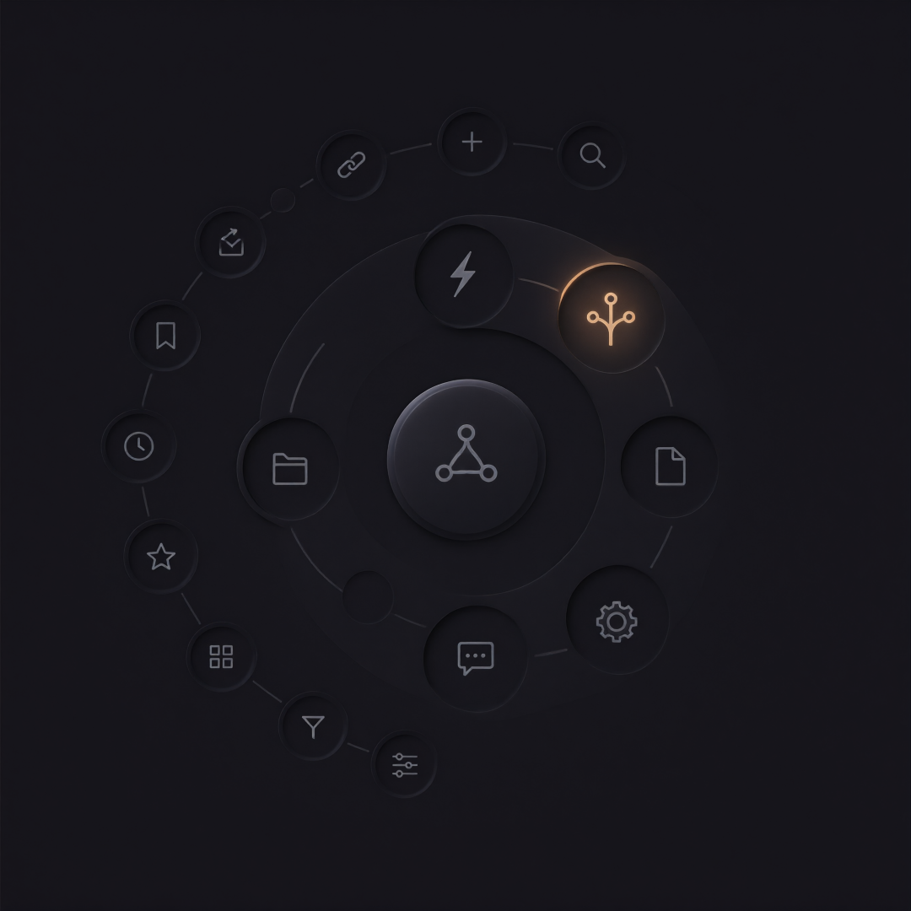 |

| v3 — pinwheel, colour icons | v4 — pinwheel, labeled |
|---|---|
| 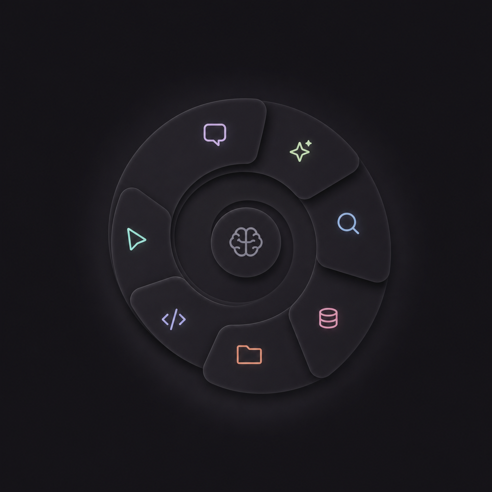 | 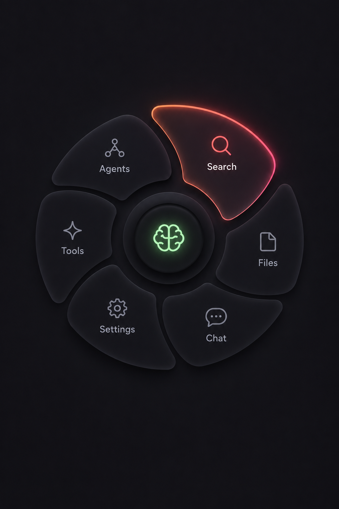 |

- **v1 — wedge ring:** eight raised wedges (Add Node, Split, Merge, Export, History, Pin, Duplicate,
  Settings) around a recessed center with the Taproot cursor mark. Hover is shown by a coral → rose arc
  on the outer rim. Root-shaped Split/Merge icons carry the brand. The most physical and neumorphic of
  the four.
- **v2 — true spiral:** primary actions on the inner ring (triggers, branch — highlighted in coral —
  file, settings, chat, folder), secondary actions trailing outward on smaller buttons (search, add,
  link, share, bookmark, history, favourite, grid, filter, sliders). Distance along the spiral shows
  priority; scales to many actions.
- **v3 — pinwheel, colour icons:** seven offset blades around a brain center; each icon has its own
  hue (outside the palette unless each colour gets a meaning, e.g. edge/handle type).
- **v4 — pinwheel, labeled:** six curved blades (Agents, Search, Files, Chat, Settings, Tools), mint
  brain center, selected blade gets a coral → rose rim and faint warm fill. Closest to the palette.
- **Suggestion (not decided):** menus need not compete — e.g. v1 for node/selection actions and v2 for
  empty-canvas actions. Final choice should be made in a prototype on the real canvas.

---

## 12. Roadmap

**Phase 1 — Foundation (see `PHASE_1_PLAN.md`).** Stand up the skeleton and the thinnest end-to-end
path: open the app, flip to the Agent surface, run a one-node agent flow through the daemon, and see
streamed output.
- Stream 0 — contracts & scaffolding (monorepo layout, daemon API + WS event schema, DB schema, CI).
- Stream A — Python daemon packaging & lifecycle (highest risk; spike first).
- Stream B — Electron shell adoption + flip container + promote design system to `packages/ui`.
- Stream C — flow editor port + React / React Flow consolidation.
- Stream D — adopt/extend `flowcore` + provider abstraction (Gemini adapter first).
- Stream E — SQLAlchemy data layer + flow persistence by reference.

**Phase 2+ (deferred):** parallel execution + per-port async, Loop node, Diff node + approval gates,
Project Board, the five-surface workspace + mini-compass, ECP, Tool Builder + built-in tool catalog,
Agent States, RAG nodes + user data sources, the full per-tool venv sandbox, live mode/TTS, non-Gemini
providers beyond stubs.

**Out of scope for the MVP:** remote/cloud daemon or multi-user sync; marketplace/sharing; non-Python
custom tools; container/gVisor sandboxing (fast-follow); Postgres as the tested default; mobile/web
builds; porting every legacy Geminode node on day one; auto-migrating old `localStorage` flows.

---

## 13. Risks

| Risk | Severity | Mitigation |
|------|----------|------------|
| Python runtime packaging inside Electron | High | Spike first; define spawn + health-check + IPC contract early. |
| React 18 vs 19; Geminode imports both `@xyflow/react@12` and `reactflow@11` | High | Consolidate to the shell's React and `@xyflow/react` only. |
| Arbitrary Python execution + secret storage | High (security) | Timeouts, resource limits, least privilege, encrypted secrets, never log secrets; hardened sandbox as fast-follow. |
| No monorepo tooling | Medium | Establish `apps/` + `packages/`, a JS workspace manager, and a Python project. |
| Per-tool venv latency | Medium | Warm worker pool, dependency caching, interpreter reuse. |
| ECP per-turn embedding latency/cost | Medium | Debounce, cache, cap K, local embedding models. |
| Extending `flowcore` without regressions | Medium | Keep existing semantics and the `pytest` suite as a regression net. |
| Persistence is greenfield | Medium | SQLAlchemy store, board model, and vectors built from scratch. |
| Streaming/live mode over WS | Medium | Define the WS event schema early from existing engine events. |
| Submodule friction | Low | Document init; consider vendoring if churn is high. |

---

## 14. Open questions

Design
1. **Radial menu:** which variant(s) — v1, v2, v3, v4, or a combination by context? (Decide in a
   prototype on the canvas.)
2. **Node outputs:** what do the paired hollow + filled circles on each output mean (v2/v3)?
3. **Handle and edge colours:** map data types to palette colours, or use a separate type palette?
4. **Top-center notch:** is it the current-surface indicator / mini-compass home?
5. **Palette finality:** is the five-colour palette final? What are the exact semantic roles of lilac
   and mint?
6. **Node variant:** v1, v2, or v3 as the base node style (or a blend)?

Product
7. Project Board details (flagged for a later scoping round).
8. Concept Designer and Knowledge Base: detailed interaction design is not yet specified.
9. Language-specific emergent features: which languages first, and what features?
10. Trigger/schedule model for invoking flows (types of triggers, where they are configured).

Engineering
11. Python-in-Electron packaging approach (embeddable Python / PyInstaller / `uv`).
12. JS workspace manager and Python project tooling (pnpm recommended; `uv` or Poetry).
13. Verify the belief-graph Gemini extractor against a real key.

---

## 15. Glossary

- **Agent State** — a named configuration bundle on an agent node, switchable at runtime via flow
  handles.
- **Daemon** — the local Python (FastAPI + WS) process that executes flows, runs tools, and serves the
  Electron client.
- **Diff node** — planned node that renders two code versions; paired with a UI pause for approval.
- **ECP (Emergent Context Protocol)** — meta-RAG that narrows an agent's tool list each turn based on
  embedded scenario descriptions.
- **Edge drawer** — contextual chat panel that emerges near a screen edge; absent where redundant.
- **Emergent UI** — UI that appears only when contextually useful.
- **Flow** — a node graph defining an agent workflow; stored globally, linked into projects.
- **flowcore** — the existing Python execution engine (`backend/flowcore`).
- **Mini-compass** — live miniature of the five-surface arrangement.
- **Orchestrator** — the default, fully editable flow loaded into every new chat.
- **Surface** — one of the five persistent workspace areas (IDE, Agent, Project Board, Concept
  Designer, Knowledge Base).
- **Swap-rotation navigation** — the rule-based spatial navigation between surfaces; "repeat to go
  home."

---

## 16. Artifacts & links

| Artifact | Location |
|----------|----------|
| Vision & Phase 1 plan (open PR) | https://github.com/bloomresearch/TaprootStudio/pull/1 |
| Belief-graph MCP tool (open PR) | https://github.com/bloomresearch/TaprootStudio/pull/2 |
| Concept images | `docs/design/concepts/` |
| Devin knowledge note ("Taproot Studio — Architecture & Vision") | https://app.devin.ai/knowledge |
| Original scoping session | https://app.devin.ai/sessions/65664c85ce5c4c87b4004243194222fa |
| Design review session | https://app.devin.ai/sessions/944fa7e9bdc3406ca6ba1c22c9c946fd |

---

## Appendix: concept image index

| # | File | Group | Description |
|---|------|-------|-------------|
| 01 | `01-palette.png` | Foundations | Original colour palette |
| 02 | `02-interface-reconceptualization.png` | Foundations | Populated node-editor interface concept |
| 03 | `03-abstract-base.png` | Foundations | Abstract base shell without components |
| 04 | `04-toggle-v2-gradient-rim.png` | Components | Toggle with gradient rim active state |
| 05 | `05-toggle-v3-labeled-led.png` | Components | ON/OFF toggle with mint LED |
| 06 | `06-toggle-v1.1-icon-thumb.png` | Components | Toggle with icon in thumb |
| 07 | `07-knob-v1-arc.png` | Components | Knob with gradient arc gauge |
| 08 | `08-knob-v2-ring.png` | Components | Knob with lit ring and ticks |
| 09 | `09-node-v1.png` | Nodes | Node inactive/active, v1 |
| 10 | `10-node-v2.png` | Nodes | Node inactive/active, v2 |
| 11 | `11-node-v3.png` | Nodes | Node inactive/active, v3 |
| 12 | `12-radial-v1-wedge-ring.png` | Radial menus | Eight-wedge ring (node actions) |
| 13 | `13-radial-v2-spiral.png` | Radial menus | True spiral with priority by radius |
| 14 | `14-radial-v3-pinwheel-color.png` | Radial menus | Pinwheel with colour-coded icons |
| 15 | `15-radial-v4-pinwheel-labeled.png` | Radial menus | Labeled pinwheel with gradient selection |
